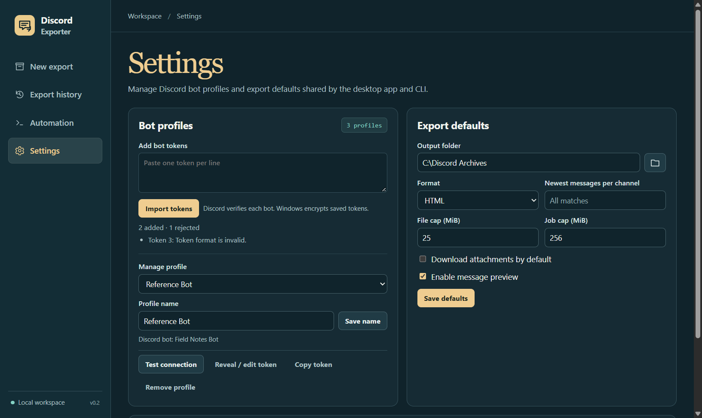
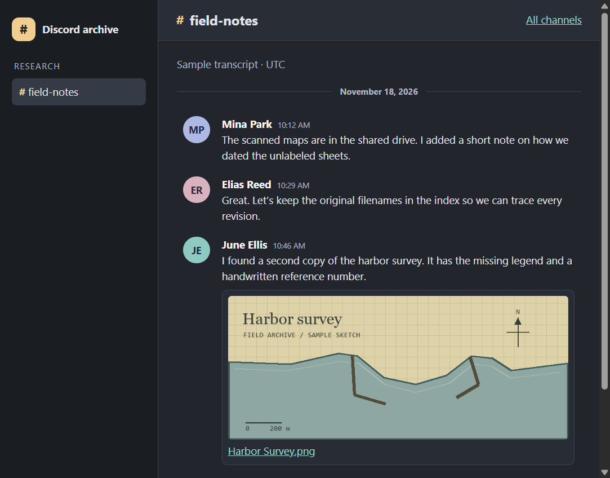

# Discord Exporter


Export Discord server history from a Windows desktop app or from a CLI designed for scripts and AI agents. Both share bot profiles, the export engine, settings, and history.

## Open on Windows

1. Install Node.js 24 or later. Run `Setup.cmd` once to install the desktop runtime.
2. Open `Open Discord Exporter.cmd`. The desktop workspace opens directly to your Discord servers or prompts you to add a bot token in Settings.
3. For a live export, create or use a bot in the [Discord Developer Portal](https://discord.com/developers/applications), install it in the server, and give it **View Channel** and **Read Message History** for the channels you want. Enable [Message Content](https://support-dev.discord.com/hc/en-us/articles/6207308062871-What-are-Privileged-Intents) so the API can return message text and attachments.
4. Open **Settings → Bot profiles** and paste one or more bot tokens, one per line. Click **Import tokens**. The app checks each token with Discord and names the profile after the bot. Choose a profile to rename it or click **Reveal token** to view and edit its saved token. **Copy token** copies it without revealing it. A replacement for a named profile must belong to the same bot.
5. In **New export**, choose a **Bot profile** and then a **Server**. Select individual items, categories, or all listed items. Search and the channel/thread filter narrow the scope of Select All. **Find archived threads** includes additional threads the bot can read. **Preview** opens recent messages on demand.
6. Choose one or more formats, pick optional transcript details, and turn on **Download attachment files** if you want offline copies. Click **Start export**. The job continues when you close the app and resumes with the profile it started with. **Export history** shows progress, pause, resume, and completed folders. **Automation** copies the current selection as a PowerShell command.

| Format | Use |
| --- | --- |
| HTML | Read offline in a chat layout with date dividers, reply links, and inline previews for supported media. Start at the bundle’s `index.html`. |
| JSONL | Stream one message per line to a script or agent. |
| Markdown | Read or index portable text with source links. |
| JSON | Read a compact, valid JSON document per channel. Resolve `authorId` through the shared `authors.json`. Optional fields omit empty values. |

Every run creates a dated folder with one transcript per channel and format. A run with multiple formats puts them in separate subfolders and writes downloaded files once to the shared `assets/` folder. `manifest.json` records scope, counts, attachment skips, and unreadable channels. Optional attachment copies are capped by both file size and job size. The default output folder is `%LOCALAPPDATA%\DiscordExporter\exports`. Settings, history receipts, and bot profiles live in the parent folder. The Windows account encrypts saved tokens. An earlier saved token appears as **Saved bot**. `DISCORD_EXPORTER_HOME` can isolate the entire profile. Automation can inject `DISCORD_BOT_TOKEN` for its process.

## CLI quick start

Run these from the repository. The CLI only needs Node and runs without `npm install`.

```powershell
.\bin\discord-export.cmd doctor --print-json
.\bin\discord-export.cmd schema --print-json
.\bin\discord-export.cmd profiles --print-json
.\bin\discord-export.cmd guilds --profile BOT_PROFILE_ID --print-json
```

See [AI_USAGE.md](AI_USAGE.md) for channel discovery, precedence, incremental exports, and the stable stdout contract.

## Desktop screenshots

Captured from the running application with fictional messages.







## Scope and maintenance

Live operation uses the [Discord v10 bot API](https://docs.discord.com/developers/resources/message#get-channel-messages). The first release covers server channels and accessible threads. It does not export personal DMs or provide a drop-in replacement for Tyrrrz's export schema. Discord link references can expire, and unavailable, skipped, or undownloaded attachments are recorded as such. HTML and Markdown show plain text and links. JSON and JSONL also retain structured embeds and related metadata. Export activity sends requests to Discord and optional attachment requests to Discord's CDN. Files and settings stay local, with no AI API calls.

Inspired by [Tyrrrz/DiscordChatExporter](https://github.com/tyrrrz/DiscordChatExporter). This is an independent implementation.

`core/` holds the API, Windows credential storage, exporter, and formatters. `desktop/` holds the sandboxed interface. `cli.mjs` is the automation entry point. SQLite saves job checkpoints on disk. Workers read history newest-first, render oldest-first, and can resume after an interruption. A job is published at its final path only after all formats and the manifest are ready.

`npm test` covers the CLI contract, UTC filtering, pagination, rate limits, bounded attachments, shared media, archived thread discovery, Windows encryption, and checkpointed resume. To repeat the actual desktop exercise on a fresh disposable profile:

```powershell
$env:DISCORD_EXPORTER_QA = 'C:/Users/marin/agent-files/trash/project-reviews/tool-discord-exporter/new-desktop-check'
$env:DISCORD_EXPORTER_HOME = "$env:DISCORD_EXPORTER_QA/state"
Remove-Item Env:DISCORD_BOT_TOKEN -ErrorAction SilentlyContinue
node scripts/verify-desktop.cjs
```

The QA writes screenshots and `ui-check.json` to the given folder. It exercises the real desktop app with fictional data, then opens the generated HTML transcripts and directory. Tests use a mock Discord API to cover pauses and permissions. Check credentials with `check --print-json` before a live run. See [AGENTS.md](AGENTS.md) before changing the shared contracts.
