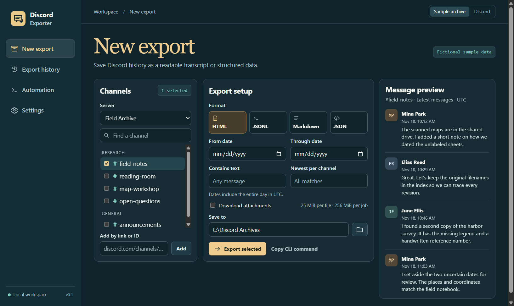
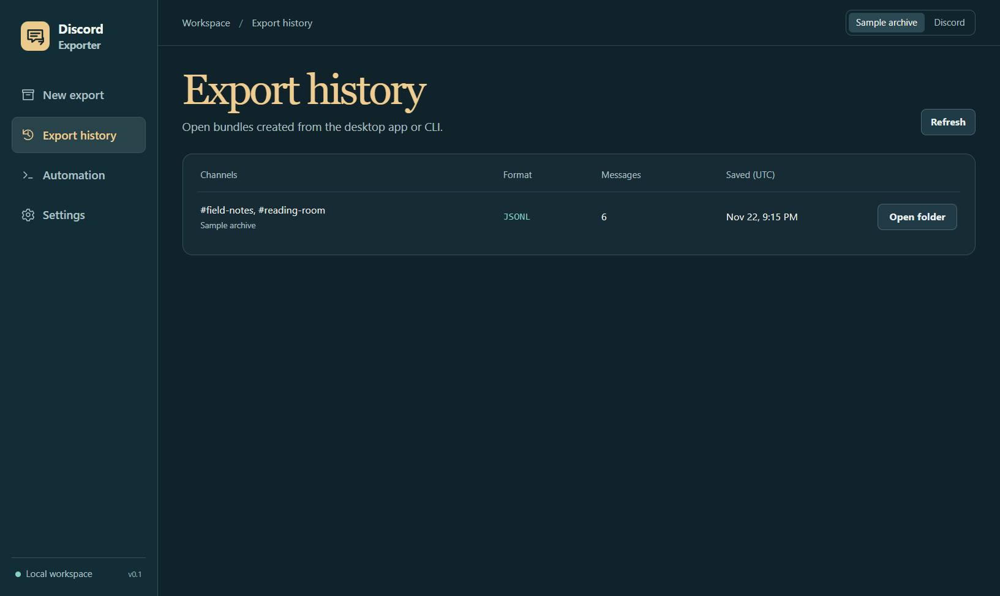

# Discord Exporter


Export Discord server history from a Windows desktop app or from a CLI designed for scripts and AI agents. Both share the same bot connection, export engine, settings, and history.

## Open on Windows

1. Install Node.js 24 or later. Run `Setup.cmd` once to install the desktop runtime.
2. Open `Open Discord Exporter.cmd`. The **Sample archive** works offline and exports fictional messages.
3. For a live export, create or use a bot in the [Discord Developer Portal](https://discord.com/developers/applications), install it in the server, and give it **View Channel** and **Read Message History** for the channels you want. Enable [Message Content](https://support-dev.discord.com/hc/en-us/articles/6207308062871-What-are-Privileged-Intents) so the API can return message text and attachments.
4. Open **Settings**, paste the bot token, click **Save token**, then **Test connection**. Click **Discord**, select channels, choose a format and output folder, and click **Export selected**. An archived thread can be added directly by channel link or ID if the bot has access.
5. Use **Export history** to open the resulting folder, or **Automation** to copy the current selection as a PowerShell command.

| Format | Use |
| --- | --- |
| HTML | Read the transcript offline. The output displays message text and links to source messages and attachments. |
| JSONL | Stream one message per line to a script or agent. |
| Markdown | Read or index portable text with source links. |
| JSON | Read a structured archive for one channel at a time. |

Every run creates a dated folder with one transcript per channel and a manifest recording the exact selection, counts, message IDs, and warnings. Optional attachment copies are capped by both file size and job size. The default output folder is `%LOCALAPPDATA%\DiscordExporter\exports`. Settings, history receipts and the Windows account encrypted credential live in the parent folder. `DISCORD_EXPORTER_HOME` can isolate the entire profile. Automation can inject `DISCORD_BOT_TOKEN` for its process.

## CLI quick start

Run these from the repository. The CLI only needs Node and runs without `npm install`.

```powershell
.\bin\discord-export.cmd doctor --print-json
.\bin\discord-export.cmd schema --print-json
.\bin\discord-export.cmd export --demo --channel 1200000000000000010 --format jsonl --print-json
```

See [AI_USAGE.md](AI_USAGE.md) for channel discovery, precedence, incremental exports, and the stable stdout contract.

## Desktop screenshots

Captured from the running application with fictional messages.





## Scope and maintenance

Live operation uses the [Discord v10 bot API](https://docs.discord.com/developers/resources/message#get-channel-messages). The first release covers server channels and accessible threads. It does not export personal DMs or provide a drop-in replacement for Tyrrrz's export schema. Discord link references can expire, and unavailable, skipped, or undownloaded attachments are recorded as such. HTML and Markdown show plain text and links. JSON and JSONL also retain structured embeds and related metadata. Export activity sends requests to Discord and optional attachment requests to Discord's CDN. Files and settings stay local, with no AI API calls.

Inspired by [Tyrrrz/DiscordChatExporter](https://github.com/tyrrrz/DiscordChatExporter). This is an independent implementation.

`core/` holds the API, Windows credential storage, exporter, and formatters. `desktop/` holds the sandboxed interface. `cli.mjs` is the automation entry point. SQLite stages one channel at a time on disk so large runs can write oldest-first while reading paginated history newest-first.

`npm test` covers the CLI contract, UTC filtering, pagination, rate limits, bounded attachments, failure cleanup, and Windows encryption. To repeat the actual desktop exercise on a fresh disposable profile:

```powershell
$env:DISCORD_EXPORTER_QA = 'C:/Users/marin/agent-files/trash/project-reviews/tool-discord-exporter/new-desktop-check'
$env:DISCORD_EXPORTER_HOME = "$env:DISCORD_EXPORTER_QA/state"
Remove-Item Env:DISCORD_BOT_TOKEN -ErrorAction SilentlyContinue
npm start -- --qa
```

The QA writes screenshots and `ui-check.json` to the given folder. The initial release was checked with the sample archive and a mock Discord API. To complete live verification, save a fresh token and run `check`, `channels`, and a one-channel `export --limit 10 --no-attachments` with an approved test channel. See [AGENTS.md](AGENTS.md) before changing the shared contracts.
